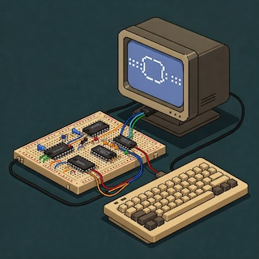

# Clementina 6502



[](https://goreportcard.com/report/github.com/fran150/clementina-6502)
[](https://golang.org/doc/devel/release.html)
[](https://www.gnu.org/licenses/gpl-3.0)
[](https://codecov.io/gh/fran150/clementina-6502)
[](https://pkg.go.dev/github.com/fran150/clementina-6502)

## Overview

Clementina 6502 is a cycle-accurate emulator for the Clementina computer, a
65C02 machine whose clock, video, audio, input and SD card come from MIA, a
Raspberry Pi Pico 2 W ([clementina-mia](https://github.com/fran150/clementina-mia)).
It also emulates [Ben Eater's 6502 computer](https://eater.net/6502), the
project it grew from, and it can run the CPU side of Clementina on a
Raspberry Pi 5 wired to a real MIA.

`-m` (`--model`) picks the machine:

| `-m` | What runs |
| --- | --- |
| `clementina` (default) | The 65C02, RAM and VIA, plus an emulated MIA. The screen and keyboard are in the [video client](https://github.com/fran150/clementina-video-client), which talks to the emulator over UDP. See [Clementina](#clementina). |
| `clementina-gpio` | The 65C02, RAM and VIA on a Raspberry Pi 5, driving a real Pico running the MIA firmware through the GPIO header. See [Clementina on GPIO](#clementina-on-gpio). |
| `beneater` | Ben Eater's computer: 65C02, VIA, ACIA, LCD, 32 KiB RAM and 32 KiB ROM. See [Ben Eater's computer](#ben-eaters-computer). |

Every model has the same terminal debugger: CPU state, the code around the
program counter, memory, the VIA, the buses, breakpoints and single-stepping.

## Why?

My journey with computers began in the 1980s when my dad brought home a Commodore 64. Those first BASIC programs I wrote sparked a passion for programming that's stuck with me ever since. I've always wanted to build my own computer from scratch, but my electronics skills weren't quite up to the task (I also wanted to create an OS, a programming language, a game...¯\_(ツ)_/¯).

Then one day I discovered Ben Eater's breadboard computer videos. I was completely hooked and couldn't stop watching. While I wanted to build Ben's 6502 computer, I also had ideas about extending it with my own modifications. That's when it clicked - why not create a software emulation instead?

There are already some great implementations out there, like the [Java 6502 Emulator](https://github.com/DylanSpeiser/Java-6502-Emulator), but I wanted to build my own from the ground up. I challenged myself to work primarily from reference documentation, only peeking at existing implementations when absolutely necessary. And why Go instead of a systems language like C or Rust? Simple - this project is my playground for fun and learning, and I just wanted to take Go for a ride!

## Clementina

### What is emulated

- **65C02S CPU**, cycle accurate, with the full 65C02 instruction set.
- **32 KiB base RAM** at `$0000-$7FFF` and **512 KiB extended RAM**, seen as
  32 banks of 16 KiB at `$8000-$BFFF` (VIA port A picks the bank).
- **65C22 VIA** at `$C000`.
- **MIA** at `$FFE0-$FFFF`, emulated in Go:
  - the boot loader, which copies the kernel image (kernel, WozMon and BASIC)
    into RAM at `$0400` and starts it, so there is no ROM;
  - 256 KiB of MIA RAM behind the indexed windows;
  - video, served over UDP to the video client;
  - Wi-Fi input (keyboard, mouse, gamepads), also over UDP;
  - audio, played through the host's sound output;
  - the SD card, backed by a host folder;
  - the `PHI2` clock speed setting;
  - the USB console, on a serial port.

The kernel image is
[`assets/computer/mia/kernel.bin`](assets/computer/mia/kernel.bin), built in
[clementina-rom](https://github.com/fran150/clementina-rom) and embedded in
the binary at build time, as are the character sets and the palette. The
memory map is
[Mapping the Clementina](https://github.com/fran150/clementina-rom/blob/main/docs/memory-map.md),
and the MIA registers are in the
[MIA README](https://github.com/fran150/clementina-mia/blob/main/README.md).

### Quick start

Run the emulator from this repository, with the sample SD card in `SD/`:

```bash
go run ./cmd --sd SD
```

Then start the video client from the
[clementina-video-client](https://github.com/fran150/clementina-video-client)
repository:

```bash
go run ./cmd/clementina-video-client
```

The video client window shows the Clementina screen and sends the keyboard,
mouse and gamepads; the emulator's terminal shows the debugger. Both default
to `127.0.0.1:6502` for video and `127.0.0.1:6503` for input, so they find
each other with no flags. Type `DIR` in BASIC to list
the SD card and `LOAD "demo.bas"` to load a sample program.

### Video and input over UDP

`--video-udp` and `--input-udp` are the addresses the emulated MIA listens on.
The defaults accept only clients on the same machine. To run the video client
on another computer, listen on every interface and point the client at the
emulator's host:

```bash
go run ./cmd --sd SD --video-udp 0.0.0.0:6502 --input-udp 0.0.0.0:6503
go run ./cmd/clementina-video-client --server 192.168.1.50:6502
```

Neither service has authentication, the same as on the real MIA, so only do
this on a network you trust. An empty address turns a service off
(`--video-udp ""`).

### SD card

`--sd` mounts an existing host folder as MIA's SD card; without it the slot
is empty. The `SD/` folder in this repository has a few sample BASIC and
assembly programs. File names are matched exactly as the host stores them, so
on Linux they are case-sensitive, unlike on a FAT card. The BASIC file
statements are in clementina-rom's
[basic-file.md](https://github.com/fran150/clementina-rom/blob/main/docs/basic-file.md).

### Speed

`-s` (`--speed`) is the target CPU clock in MHz; the default, 1.2, is MIA's
default `PHI2`. On Clementina the emulator asks the emulated MIA for the same
`PHI2`, and MIA keeps it between 1 Hz and 8 MHz, so `-s 20` runs at 8 MHz. It
works the other way too: when a program or the MIA console's `speed` command
changes `PHI2`, the emulator follows. The Speed menu raises or lowers the
target in steps of 0.1 MHz (smaller steps below 1 MHz). The host may not keep
up with a high target; on exit the emulator prints the cycles it ran and the
speed it reached.

### MIA console

On Clementina, `-p` (`--port`) connects a serial port to the emulated MIA's
USB console at 115200 baud, 8N1. It has the same commands as the real board
(`help`, `status`, `speed`, `exec pause`, `monitor` and the rest, listed in
the MIA README's
[USB Console](https://github.com/fran150/clementina-mia/blob/main/README.md#usb-console)
section). `input console` turns that terminal into the Clementina keyboard
until `Ctrl+Q`.

Without hardware, `socat` makes a pair of linked virtual serial ports:

```bash
socat -d -d pty,raw,echo=0,link=/tmp/ttyComputer pty,raw,echo=0,link=/tmp/ttyTerminal
go run ./cmd --sd SD -p /tmp/ttyComputer
```

Then open `/tmp/ttyTerminal` with any terminal program. The console has been
tested with `socat` only, not yet with a real serial port.

### Headless automation

`cmd/clementina-automation` runs one Clementina with no terminal, no UDP
services and no serial port, controlled through a JSON request endpoint on a
loopback TCP port. The SDK's `clementina run` and its emulator client use it.

```bash
go build -o clementina-automation ./cmd/clementina-automation
./clementina-automation -sd /path/to/folder
```

`-sd` mounts a folder as the SD card (empty slot without it), and `-port`
picks the port (by default it chooses a free one and prints the endpoint).
The protocol is in clementina-sdk's
[emulator automation](https://github.com/fran150/clementina-sdk/blob/main/docs/emulator-automation.md)
page and
[`specs/emulator-automation.json`](https://github.com/fran150/clementina-sdk/blob/main/specs/emulator-automation.json).

## Clementina on GPIO

`-m clementina-gpio` runs the 65C02, RAM and VIA on a Raspberry Pi 5 and
connects them through the GPIO header to a Pico running
[clementina-mia](https://github.com/fran150/clementina-mia), so the MIA
firmware can be tested against a 6502 before the board exists. It only runs on
Linux on ARM (other builds print an error), and it uses only two flags:
`--gpio-chip` (default `gpiochip4`, the Pi 5 header; some kernels name it
`gpiochip0`) and `-f`. Everything else
comes from the real MIA: the clock, video, input, SD card and console.

The wiring is in [GPIO_PIN_MAP.md](GPIO_PIN_MAP.md). `cmd/gpiobench` measures
the latency of the GPIO calls the bridge makes on every cycle; run it on the
Pi with the emulator stopped:

```bash
go run ./cmd/gpiobench -chip gpiochip4 -n 100000
```

Build it on the Pi itself (see [Building](#building)): `make build-all`
can't cross-build Linux ARM binaries yet.

## Ben Eater's computer

`-m beneater` runs Ben Eater's 6502 computer:

- **65C02S CPU**, cycle accurate.
- **65C22S VIA** with timers and I/O ports.
- **65C51N ACIA** for serial communication.
- **HD44780U LCD** controller (no custom characters yet).
- **32 KiB RAM and 32 KiB ROM**.

By default it loads `./assets/computer/beneater/eater.bin`, Ben's ROM with
WozMon and Microsoft BASIC (see
[beneater/msbasic](https://github.com/beneater/msbasic)). The path is relative
to the current directory, so run from the repository or release folder, or
pass another image with `-r` (`--rom`).

### Serial port

`-p` connects the ACIA to a serial port. The port settings come from the
ACIA's control register, so the ROM decides them; Ben's ROM sets 19200 baud,
8 data bits, no parity and 1 stop bit. The same `socat` pair works for testing
without hardware:

```bash
socat -d -d pty,raw,echo=0,link=/tmp/ttyComputer pty,raw,echo=0,link=/tmp/ttyTerminal
go run ./cmd -m beneater -p /tmp/ttyComputer
```

`-e` (`--emulate-modem`) adds the RTS, CTS, DTR and DSR modem lines. The
serial port has been tested with `socat` only, and the modem lines have not
been tested.

### Debugging tips

If you are testing the emulator with your own image, it includes some debugging tools to help you:

1. **Use breakpoints** to pause execution at specific addresses
1. **Single-step** through code to observe CPU and component behavior
1. **Monitor the bus window** to see data flow between components
1. **Adjust emulation speed** for better observation of fast operations
1. **Check the ACIA window** when debugging serial communication issues

## Command line options

| Flag | Models | Default | Meaning |
| --- | --- | --- | --- |
| `-m`, `--model` | all | `clementina` | `clementina`, `clementina-gpio` or `beneater`. |
| `-s`, `--speed` | clementina, beneater | `1.2` | Target CPU clock in MHz. On Clementina, MIA's `PHI2` follows it, between 1 Hz and 8 MHz. |
| `-f`, `--fps` | all | `15` | Terminal debugger refresh rate. |
| `-p`, `--port` | clementina, beneater | none | Serial port. Clementina: the MIA console at 115200 baud. Ben Eater: the ACIA. |
| `--sd` | clementina | none | Existing host folder mounted as the SD card. Without it the slot is empty. |
| `--video-udp` | clementina | `127.0.0.1:6502` | Address the MIA video service listens on. Empty turns it off. |
| `--input-udp` | clementina | `127.0.0.1:6503` | Address the MIA input service listens on. Empty turns it off. |
| `--charset` | clementina | `clascii` | Character set MIA loads at boot: `clascii` (the MIA firmware's) or `openroms`. |
| `--palette` | clementina | `clementina-text` | Palette MIA loads at boot. `clementina-text` is the only one. |
| `--gpio-chip` | clementina-gpio | `gpiochip4` | GPIO chip with the Pi header lines. |
| `-r`, `--rom` | beneater | `./assets/computer/beneater/eater.bin` | ROM image to load. |
| `-e`, `--emulate-modem` | beneater | `false` | Emulate the serial port's modem lines (untested). |

The terminal debugger's menu is at the bottom of the screen: `E` for
emulation (reset, pause, resume, step, breakpoints, speed), `V` to pick a
window (on Clementina, `F1`-`F5`: CPU, VIA, base RAM, extended RAM and
buses) and `Q` to quit. Memory windows scroll with the arrow keys and Page
Up/Down, and `G` goes to an address.

## Building

### Requirements

- **Go 1.23 or later**
- **Linux:** a C compiler and the ALSA headers (`libasound2-dev` on Debian,
  Ubuntu and Raspberry Pi OS), because the audio library uses cgo there.
  macOS and Windows need nothing extra.
- **A terminal with ANSI color**, at least 80x24 characters
- **For serial ports on Linux**, permission to open them (see
  [Troubleshooting](#troubleshooting))

### From source

```bash
git clone https://github.com/fran150/clementina-6502.git
cd clementina-6502

# Build build/bin/clementina for this machine
make build

# Or run without building
go run ./cmd
```

Before a pull request, run `make test`, `make lint` (needs `golangci-lint`)
and `make check-docs`, which match the CI checks; see
[CONTRIBUTING.md](CONTRIBUTING.md).

### Pre-built binaries

The [published releases](https://github.com/fran150/clementina-6502/releases)
(the latest is v0.3.0, May 2025) predate the Clementina model: they emulate
only Ben Eater's computer, and their `-s` is an older "skip cycles" option.
Build from source to run Clementina.

`make release VERSION=x.y.z` builds zip packages for Linux, macOS and Windows
in `build/bin`, but it stops at the Linux cross builds (see
[Known issues](#known-issues-and-limitations)). The macOS package includes
`setup-macos.sh`, which removes the download quarantine flag.

### As a Go package

To use Clementina 6502 as a Go package:

```bash
go get github.com/fran150/clementina-6502@latest
```

## Troubleshooting

### Serial Port Access Denied
```bash
# Linux: Add user to dialout group
sudo usermod -a -G dialout $USER
# Log out and back in for changes to take effect
```

### No picture in the video client
- Check that the emulator is running the Clementina model (the default).
- Check that the client's `--server` matches the emulator's `--video-udp`
  port, and that `--video-udp` isn't bound to `127.0.0.1` when the client is on
  another machine.

### Emulation Performance Issues
- Lower the debugger refresh rate (`-f` flag)
- Lower the target speed (`-s` flag)

### Display Rendering Issues
- Verify terminal supports ANSI escape codes
- Check terminal window size (minimum 80x24 required)
- Try different terminal emulators

## Performance Profiling

For profiling CPU performance:

```bash
go test -benchmem -run=^$ -bench ^BenchmarkProcessor$ github.com/fran150/clementina-6502/tests -cpuprofile clementina6502.prof
go tool pprof -http :8080 clementina6502.prof
```

## Known Issues and Limitations

1. Serial ports, the MIA console and the Ben Eater ACIA alike, have been tested with `socat` only, not yet with a real port and terminal.
1. The Ben Eater modem line emulation has not been tested.
1. `make build-all` and `make release` stop at the Linux arm64 and 386 targets: the audio library needs cgo on Linux, and a cross build has no C toolchain. Build Linux binaries on the machine that runs them.

## Contributing

Contributions are welcome! See [CONTRIBUTING.md](CONTRIBUTING.md), and feel free to submit a Pull Request.

## License

GPLv3. See [LICENSE](LICENSE).

## Acknowledgments

- [Ben Eater](https://eater.net/) for the [original 6502 computer design](https://eater.net/6502)
- The Go community for excellent libraries and tools
- Amazing 6502 reference http://www.6502.org/users/obelisk/65C02/reference.html
- Very detailed description of 6502 / 6510 processors: https://www.atarihq.com/danb/files/64doc.txt. I used it to read about the intermediate cycles for each instruction.
- More 6502 references: http://www.6502.org/tutorials/65c02opcodes.html
- Details about the VIA chip: https://lateblt.tripod.com/bit67.txt
- 6522 reference: https://web.archive.org/web/20160108173129if_/http://archive.6502.org/datasheets/mos_6522_preliminary_nov_1977.pdf
- Another 6522 reference: https://swh.princeton.edu/~mae412/TEXT/NTRAK2002/20.pdf
- LCD Simulator: http://www.dinceraydin.com/djlcdsim/djlcdsim.html I've used it to test the behaviour of certain instructions.
- Details about HD44780 addressing with different LCDs: https://web.alfredstate.edu/faculty/weimandn/lcd/lcd_addressing/lcd_addressing_index.html
- Amazing JAVA Emulator for Ben's computer: https://github.com/paulfisher53/Java-6502-Emulator
